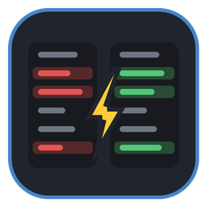

# LiteDiff



Könnyű, VS Code-szerű git diffnéző Windowsra.

**Az ötlet:** Manapság a fejlesztés egyre inkább MI-vel történik: promptokkal vagy MI-asszisztenssel. A kódot egy ügynök írja, parancssorból és szkriptekkel dolgozik, így fejlesztőkörnyezetre legtöbbször nincs szükség. Ami viszont kell, az a kód átnézése. Erre való ez az eszköz: nézd át a változásaidat két oszlopban vagy egy oszlopban, javítsd ki az apróbb hibákat – a többit intézi az MI. Utána jöhet a commit és a push!

Python, [pywebview](https://pywebview.flowrl.com/) (WebView2) és a [Monaco Editor](https://microsoft.github.io/monaco-editor/) (a VS Code szerkesztője) alapokon. Nagyjából 220 MB memóriát használ.

## Mit tud?

- **Több repó** egy ablakban, a sorrendjük húzással állítható
- **Változott fájlok kibontott fában**, emojis állapotjelzéssel: ➕ új, ✏️ módosított, 🗑️ törölt, ➡️ átnevezett, ⚠️ ütközés
- **Két oszlopos diff** szintaxisszínezéssel, ugrás a változások között (F7 / Shift+F7), egyoszlopos mód
- **Szerkesztés és mentés** közvetlenül a diffben (Ctrl+S), automatikus frissítés, ha a fájlok változnak
- **Gyors ágváltás** kereshető áglistából
- **Commit-történet** repónként: az ág saját commitjai kiemelve, az alapágról jövők szürkén, a pusholatlanok jelölve; egy commitot lenyitva látszanak a fájljai és a diffjeik
- **Pull request nézet**: minden, amit az ágad a leágazás óta megváltoztatott (commitolt és commitolatlan), egyetlen listában. Az alapágat magától felismeri (VS Code-beállítás → reflog → legközelebbi ág), vagy kézzel választható
- **Jobbklikk-műveletek**: fájl visszaállítása, teljes útvonal másolása, commit, commit és push, push

## Indítás

Töltsd le a `LiteDiff.exe`-t a kiadások (Releases) közül: egyetlen, kb. 15 MB-os fájl, telepíteni nem kell. Windows 10/11 kell hozzá, a szükséges WebView2 futtatókörnyezet ezekben már benne van. Indítás után a ＋ gombbal adj hozzá egy repómappát; ha a mappa maga nem repó, az almappáiban lévő repók kerülnek be.

Forrásból:

```powershell
py -3.12 -m venv .venv
.venv\Scripts\python.exe -m pip install -r requirements.txt
.venv\Scripts\pythonw.exe LiteDiff.pyw
```

Részletes leírás: [docs/LEIRAS.md](docs/LEIRAS.md)

## Licenc

A Monaco Editor az MIT licenc alatt van mellékelve (`litediff/web/vendor/MONACO_LICENSE`).
